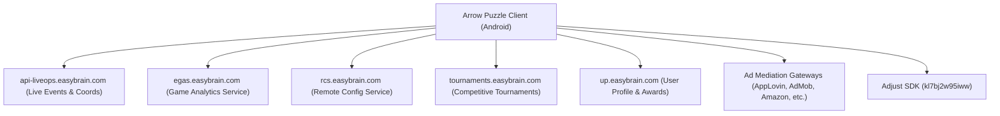
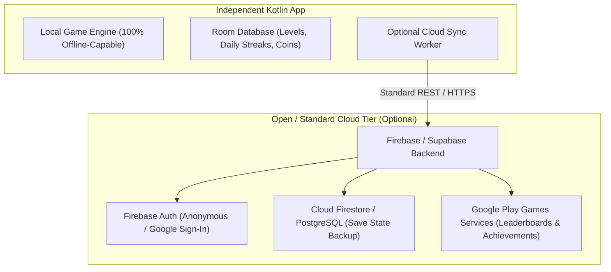

# API & Backend Infrastructure Analysis

## 1. Executive Summary & Forensic Findings

Static inspection of the application manifest, decompiled network modules, and IL2CPP metadata strings revealed extensive network capabilities. The original application is deeply coupled to **Easybrain's proprietary backend cloud infrastructure**, primarily for live operations, analytics telemetry, dynamic remote configuration, tournament leaderboards, and ad mediation.

---

## 2. Identified Remote Endpoints & Services

### 2.1. Proprietary Easybrain Cloud Services

| Domain / URI Path | Protocol & Version | Primary Function | Forensic Source |
| :--- | :--- | :--- | :--- |
| **`arrowpuzzlegp.easybrain.com`** | HTTPS / TLS 1.3 | Primary app link domain & deep linking routing | AndroidManifest / Strings |
| **`egas.easybrain.com/api/v2/`** | REST / JSON / GZIP | Easybrain Game Analytics Service (EGAS) — telemetry, session timing, funnel events | IL2CPP Metadata Strings |
| **`rcs.easybrain.com`** | REST / JSON | Remote Configuration Service (RCS) — dynamic ad intervals, difficulty flags | IL2CPP Metadata Strings |
| **`tournaments.easybrain.com`** | REST / WebSockets | Competitive tournament matchmaking, live leaderboards, brackets | IL2CPP Metadata Strings |
| **`up.easybrain.com/api/v2/awards`** | REST / JSON | User Profile (UP) service — persistent awards, achievements, sync | IL2CPP Metadata Strings |
| **`api-liveops.easybrain.com/api/v2/event_core`** | REST / JSON | LiveOps management — seasonal events, themed calendar challenges | IL2CPP Metadata Strings |
| **`api-liveops.easybrain.com/api/v2/coord`** | REST / JSON | LiveOps coordinate distribution & event milestone sync | IL2CPP Metadata Strings |

*Test & Staging Sibling Endpoints*: The metadata contains corresponding QA/staging environments (`egas-test-1.easybrain.com`, `rcs-test-1.easybrain.com`, `tournamentsgo-stage.easybrain.com`, `api-liveops-test.easybrain.com`), proving active continuous integration across the service portfolio.

### 2.2. Third-Party Commercial Infrastructure

| Provider | Endpoints & Assets | Purpose in App |
| :--- | :--- | :--- |
| **Adjust** | `app.adjust.com` | User acquisition attribution, re-engagement tracking |
| **Google Firebase** | `firebaselogging-pa.googleapis.com` | Firebase Analytics, Performance Monitoring, Crashlytics |
| **Google FCM** | `fcm.googleapis.com` | Push campaigns, streak reminders, life refilling alerts |
| **Zendesk** | `easybrain.zendesk.com` | Customer support ticketing, help article distribution |
| **Ad Exchanges** | `unityads.unity3d.com`, `applovin.com`, `googleads.g.doubleclick.net`, `amazon-adsystem.com`, `mbridge.com` | Real-time bidding, video creative delivery |

---

## 3. Network Security & Transport Configuration

### 3.1. Security Manifest (`modules_network_security_config.xml`)
Forensic analysis of the decoded network security XML configuration revealed:
* **Default Baseline**: `cleartextTrafficPermitted="false"` across all standard domains (enforcing HTTPS/TLS for all external network requests).
* **Local Loopback Exception**: `cleartextTrafficPermitted="true"` for `127.0.0.1` (used for internal local proxying or debugging by ad mediation web views).
* **Ad Domain Cleartext Exceptions**: Cleartext HTTP is permitted for specific Unity Ads Akamai CDN domains (`cdn-creatives-akamai-prd.unityads.unity3d.com`, `acquire.unity3dusercontent.com`) and `epsilon.com` to accommodate legacy HTTP video creative delivery without TLS overhead.
* **Debug Overrides**: Configured to trust user certificates (`<certificates src="user" />`) in debug builds, allowing proxy inspection (via Charles or mitmproxy) during internal development.
* **Certificate Pinning**: No custom public-key pinning is enforced at the network XML level for Easybrain's primary REST domains; standard platform CA trust is utilized.

---

## 4. Architectural Limitations & Clean-Room Boundaries

> [!IMPORTANT]
> **Forensic Boundary Declaration**
> Finding remote endpoints in client metadata does **NOT** mean the backend server code, database schema, or internal algorithms have been recovered. 

1. **Private Server Logic**: Server-side systems (`egas.easybrain.com`, `tournaments.easybrain.com`, `rcs.easybrain.com`) are private, authenticated REST/RPC microservices. The backend business logic (e.g., how tournament brackets are computed or how anti-cheat is verified) executes exclusively on Easybrain servers and is **not reproducible from the APK alone**.
2. **Dynamic Configurations**: Values downloaded from `rcs.easybrain.com` (such as live ad intervals or A/B testing thresholds) represent server-side parameters that fluctuate dynamically.
3. **Clean-Room Replacement Strategy**:
   - For an independent rebuild, attempting to communicate with Easybrain's proprietary servers is neither necessary nor ethical.
   - The reimplementation must operate **100% offline-first**: all core game logic, level progression, and daily challenges must function autonomously on the device without requiring remote server connectivity.

---

## 5. Recommended Architecture for Clean Rebuild Backend

If online features (leaderboards, cloud backup, remote content) are desired in the rebuild, the following modern, self-contained architecture is recommended:

### 5.1. Replacement Stack Specifications
1. **Cloud Save & Sync (Optional)**:
   - Use **Firebase Firestore** or **Supabase** for player progress backup (storing `{ highest_unlocked_level, coins, stars, daily_challenge_history }`).
   - Allow seamless anonymous authentication that can link to a Google Play Games account.
2. **Leaderboards & Achievements**:
   - Replace proprietary tournament servers with standard **Google Play Games Services v2** (`play-services-games-v2`).
   - Free, zero-maintenance, and natively integrated into Android with built-in social leaderboards.
3. **Telemetry & Crash Reporting (Privacy-First)**:
   - Use lightweight Firebase Crashlytics or a privacy-preserving self-hosted telemetry engine (e.g., Sentry) with an opt-out toggle in Settings.
