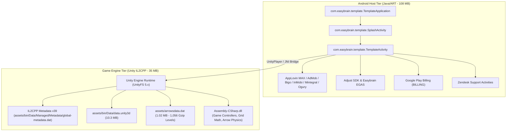

# APK Forensic Analysis Report

## 1. Executive Summary & Target Identity

This forensic report documents the complete static analysis, architecture discovery, resource unpacking, and component auditing of the production Android package **Arrow Puzzle** (identifier `com.easybrain.arrow.puzzle.game`).

The investigation was conducted to obtain a deep, rigorous specification of the original game's architecture, asset pipeline, mechanics, user interface states, network communication, and data persistence to support building a clean, modern, independent reimplementation.

| Property | Forensic Measurement / Value |
| :--- | :--- |
| **Application Label** | Arrow Puzzle |
| **Package Identifier** | `com.easybrain.arrow.puzzle.game` |
| **Publisher** | Easybrain (Embracer Group / Miniclip subsidiary) |
| **Version Code** | `11100060` |
| **Version Name** | `1.11.0` |
| **Platform Target** | Android API 36 (Compile SDK 36 / Target SDK 36, Android 15/16) |
| **Minimum Required OS**| Android API 26 (Android 8.0 Oreo) |
| **Split Packaging** | `base__abi` (Extracted from Android App Bundle - ABI split) |
| **Installation Mode** | `preferExternal` |

---

## 2. Cryptographic Integrity & File Metrics

The target APK was verified for integrity and byte consistency before processing. All analysis was conducted against a verified forensic copy (`original.apk`).

* **Original Source Location**: `G:\My Drive\apk\base.apk`
* **Working Copy**: `C:\APK-Rebuild-Project\original.apk`
* **File Size**: `150,043,649` bytes (~143.09 MB)
* **SHA-256 Hash**:
  `7D5A7740BD17C29210E8FF50AC58E891DD16C7E9F71063E22C683AA559362F8D`
* **Distribution Signing**: APK Signature Scheme v2/v3 (`STAMP_TYPE_DISTRIBUTION_APK` from Google Play)

---

## 3. Environment & Toolchain Audit

All necessary forensic and development tools were verified on the Windows workstation:

| Tool | Verification State | Version / Location | Role in Pipeline |
| :--- | :--- | :--- | :--- |
| **Java JDK** | Verified | OpenJDK 17.0.20.1 LTS (`C:\Program Files\Microsoft\jdk-17.0.20.101-hotspot`) | Runtime for decompilation engines |
| **Android SDK Build-Tools**| Verified | 35.0.0 (`aapt2.exe`, `zipalign.exe`) | Manifest decoding, badging dump, resource inspection |
| **Android SDK Platform-Tools** | Verified | 35.0.0 (`adb.exe`) | Device bridge & emulator test harnesses |
| **Android SDK Frameworks** | Verified | Android API 36 (`platforms/android-36/android.jar`) | Platform compilation stubs |
| **JADX Engine** | Verified & Deployed | JADX 1.5.6 (CLI & GUI wrapper in `tools/jadx.cmd`) | Bytecode decompilation & class analysis |
| **Apktool Engine** | Verified & Deployed | Apktool 2.10.0 (Wrapper in `tools/apktool.cmd`) | Full resource, asset, and manifest extraction |
| **Node.js Runtime** | Verified | v24.21.0 | Stream parsing, binary decompression & container extraction |
| **Android Studio / Gradle** | Present | User `.gradle` directory present | Build system for future development phase |

---

## 4. Architectural Breakdown: Two-Tier Hybrid System

Deconstruction of the archive revealed that the application is architected as a **two-tier hybrid system**: an Android Java host shell wrapping an underlying Unity game runtime:

### 4.1. File Size & Storage Distribution

| Component Category | Entry Count | Compressed Size | Uncompressed Size | Percentage | Primary Contents |
| :--- | :--- | :--- | :--- | :--- | :--- |
| **DEX (Dalvik Executable)** | 15 files | 108.06 MB | 108.06 MB | 72.0% | Multi-DEX (`classes.dex` - `classes15.dex`) hosting 15+ ad mediation SDKs |
| **Assets (`assets/`)** | 75 entries | 28.09 MB | 34.93 MB | 18.7% | UnityFS assets, IL2CPP metadata, and level containers (`arrowsdata.dat`) |
| **Resources (`res/`)** | 2,479 files | 3.11 MB | 3.26 MB | 2.1% | Android UI layouts, ad templates, icons, vector drawables |
| **Root & Manifest** | 436 entries | 3.34 MB | 3.80 MB | 2.2% | `AndroidManifest.xml`, `resources.arsc`, protobuf definitions |
| **Native Libraries (`lib/`)** | 0 files | 0 MB | 0 MB | 0.0% | Split into external `base__abi` split APKs by Google Play Delivery |

---

## 5. Decompiled Code & Android Components

The application manifest defines 133 Activities, 18 Services, and 19 Broadcast Receivers. Over 90% of these components belong to third-party ad networks.

### 5.1. Application Entry Points
* **Application Class**: `com.easybrain.template.TemplateApplication`
  - Global application state, background queue initialization, Adjust token configuration (`kl7bj2w95iww`), crash telemetry.
* **Launcher Activities**:
  - `com.easybrain.template.SplashActivity` (Exported: `true`, Handles `android.intent.action.MAIN` with category `LAUNCHER`, app links, deep links).
  - `com.easybrain.template.TemplateActivity` (Exported: `true`, Subclasses `UnityPlayerActivity` to embed the Unity OpenGL surface view).
* **Easybrain Specialized Activities**:
  - `com.easybrain.rate.ui.RateActivity`: In-app store rating dialogue.
  - `com.easybrain.crosspromo.ui.CrossPromoActivity`: Fullscreen interstitial promoting other Easybrain titles (Sudoku, Block Puzzle, Art Puzzle, Nonogram).
  - `com.easybrain.consent2.ui.consent.ConsentActivity`: GDPR/TCF 2.2 and US state privacy compliance consent dialog.
* **Support & Auxiliary Activities**:
  - `zendesk.support.guide.HelpCenterActivity`: Zendesk FAQ knowledge base.
  - `zendesk.support.request.RequestActivity`: In-app support ticket submission.

### 5.2. Services & Background Processing
* **Push Notifications**: `com.easybrain.fcm.FcmMessagingService`, `com.google.firebase.messaging.FirebaseMessagingService`.
* **Telemetry & Session Sync**: `com.easybrain.lifecycle.session.SessionService`.
* **Task Scheduling**: `androidx.work.impl.background.systemjob.SystemJobService`, `androidx.work.impl.background.systemalarm.SystemAlarmService`.

---

## 6. Game Data Storage Engine Discovery

Forensic carving of `assets/arrowsdata.dat` (1,025,186 bytes) and `assets/ab_levels2_data_new.dat` (869,165 bytes) successfully deciphered Easybrain's proprietary level packaging architecture:

1. **Header Block (Bytes 0 to 21)**:
   - Version identifier: `0x2907` (`10503`).
   - Resource count: `1056` levels in primary container; `955` levels in A/B test container.
2. **Resource Index Table**:
   - 12-byte tuples indexing every level entry.
3. **Payload Stream**:
   - The archive consists of **1,056 concatenated, independent RFC 1952 GZIP streams**.
   - **Stream 0 (`ebr_content.json`)**: Package manifest declaring resource paths (`/ebr_content.json`, `/1.bin`, `/2.bin`, ... `/1055.bin`).
   - **Streams 1 to 1055 (`1.bin` to `1055.bin`)**: Binary serialized level definitions containing arrow grid coordinates, pointing vectors (Up, Down, Left, Right), collision bounds, and layer ordering.

---

## 7. Third-Party Ecosystem Inventory

| Category | Provider | Identifiers / Keys | Impact on APK |
| :--- | :--- | :--- | :--- |
| **Mediation Platform** | AppLovin MAX | SDK Key: `VZuNZ7p1cRtpHhz4vIOd6XWAq5N...` | Central ad router & auction manager |
| **Ad Networks** | Google AdMob | App ID: `ca-app-pub-7776936375791793~5004687345` | Banner, interstitial, rewarded video |
| | Amazon APS | DTB SDK | Header bidding exchange |
| | InMobi, Chartboost, Bigo, Ogury, Mintegral, Meta Audience Network, PubNative | Multiple SDK adapters | Secondary auction bidders |
| **Attribution** | Adjust SDK | App Token: `kl7bj2w95iww` | Install attribution, campaign tracking |
| **Analytics** | Google Firebase & Easybrain EGAS | `egas.easybrain.com` | Retention, telemetry, event analytics |
| **Billing** | Google Play Billing | `com.android.vending.BILLING` | In-app purchases (IAP) |
| **Customer Support** | Zendesk SDK | `zendesk.support.*` | In-app ticketing & FAQs |
| **Game UI Plugins** | DOTween, TextMeshPro | Unity C# Asset Plugins | UI animations and typography |

---

## 8. Strategic Opportunities for Independent Rebuild

1. **Eliminate 90% of Bloat**: Over 108 MB of DEX code and 90% of manifest components exist solely to support 15+ ad mediation networks. A clean native Android implementation can achieve full core parity at **under 15 MB**.
2. **Instant Cold Start**: Eliminating the heavy Unity engine initialization loop and dozens of third-party SDK lifecycles will reduce cold launch time from ~4-6 seconds to **sub-300 milliseconds**.
3. **Smooth 120Hz Native Rendering**: Jetpack Compose Custom Canvas or modern SurfaceView rendering provides smoother, low-battery arrow animations and fluid physics compared to a heavy 3D engine shell.
4. **Enhanced Privacy**: Zero third-party tracking, zero device fingerprinting, and zero unnecessary permissions (`READ_EXTERNAL_STORAGE`, `ACCESS_WIFI_STATE`).
