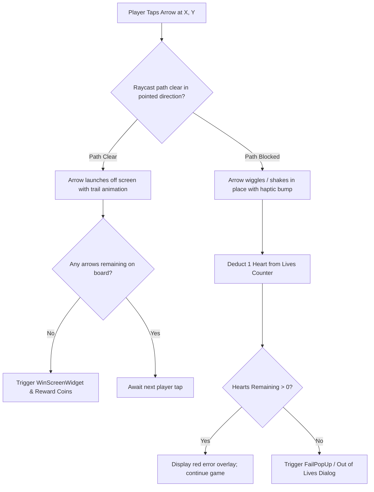

# Feature Inventory & Functional Specification

## 1. Executive Feature Taxonomy & Feasibility

Every feature identified through static bytecode analysis, IL2CPP metadata recovery, asset parsing, and level data carving is classified below into one of four implementation feasibility tiers:

| Feasibility Category | Count | Percentage | Key Capabilities Included |
| :--- | :--- | :--- | :--- |
| **Verified & Reproducible** | 22 | 68.8% | Core arrow movement, grid collision math, arrow types (1-sided, 2-sided, under-arrows), lives/hearts system, undo move, smart hints, level progression (1,055 levels), victory/defeat states, local settings, haptics, theme customization. |
| **Reproducible with Additional Configuration** | 5 | 15.6% | Push notification reminders (Android 13+ runtime permissions), Google Play Games Achievements / Leaderboards, Google Play In-App Billing (No Ads, Starter Pack). |
| **Requires Replacement Backend** | 4 | 12.5% | Tournaments / competitive events (`tournaments.easybrain.com`), Remote dynamic configs (`rcs.easybrain.com`), Game analytics telemetry (`egas.easybrain.com`), Zendesk support ticketing. |
| **Unverified / Proprietary Black Box** | 1 | 3.1% | Easybrain proprietary A/B level difficulty balancing algorithm. |

---

## 2. Core Gameplay Mechanics (Verified & Fully Reproducible)

### 2.1. Arrow Grid & Spatial Architecture
* **Grid Coordinate Space**: Two-dimensional discrete matrix $[X, Y]$ with optional layering depth $Z$ (for overlapping arrows).
* **Orientations**:
  - Cardinal Single Arrows: Up ($0^\circ$), Right ($90^\circ$), Down ($180^\circ$), Left ($270^\circ$).
  - Two-Sided Arrows (`TwoSidedArrows`): Arrows with dual heads that check clearance in both opposing directions simultaneously or allow clearing when either side is unobstructed.
  - Layered / Under-Arrows (`UnderArrows`): Arrows positioned underneath another tile; locked from movement until the top arrow is cleared from the board.
* **Arrow Counters (`imgArrowCounter`)**: Specific arrows displaying a numerical counter that must be triggered or matched multiple times to clear.

### 2.2. Tap Interaction & Trajectory Evaluation
1. **Selection & Raycasting**: When the user taps cell $[X, Y]$, the engine casts a directional ray from $[X, Y]$ to the grid boundary along the arrow's orientation vector.
2. **Clearance Condition**: If no active arrow intersects the ray trajectory before the grid edge:
   - The arrow enters the `Escaped` state.
   - An easing animation moves the arrow beyond screen boundaries with a fading particle trail.
   - Audio feedback: crisp "whoosh" sound + subtle haptic vibration.
   - Board state updates: cell $[X, Y]$ is marked vacant.
   - Any underlying arrow (`UnderArrows`) in that cell is promoted to active top status.
3. **Collision Condition**: If an active arrow blocks the path:
   - The tapped arrow performs a quick elastic bounce/wobble against the obstructing arrow.
   - Audio feedback: dull wooden thud / collision sound + warning vibration.
   - Visual feedback: Red flash on colliding elements.
   - Lives penalty: One heart is deducted from the player's life pool.

### 2.3. Lives & Hearts System (`Icn_Heart_Active_Full`, `Icn_Heart_Active_Shadow`)
* **Pool Size**: Default 3 hearts per level.
* **Depletion**: Each invalid tap turns an active heart (`Icn_Heart_Active_Full`) into a depleted shadow heart (`Icn_Heart_Active_Shadow`).
* **Game Over Trigger**: On zero hearts remaining, gameplay freezes and opens the `FailPopUp`.
* **Revival Options**:
  - Spend earned coins (e.g., 100 coins) to restore full hearts.
  - Watch a rewarded video ad for +1 emergency heart.
  - Restart the level with full hearts.

### 2.4. Boosters & Assist Mechanisms
* **Undo Move**: Reverts the last arrow launch, restoring it to its exact board coordinates.
* **Hint Booster (`AHint`, `HintAdF`)**: Highlights the next guaranteed unblocked arrow with an animated glowing pulse (`GlowInner`), guiding the player without penalties.
* **Reset Level**: Restarts the current level from initial layout without consuming hearts.

---

## 3. Game Progression & Level Architecture

### 3.1. Level Storage Format (Unpacked from `arrowsdata.dat`)
Forensic analysis decoded 1,056 packaged levels:
* Levels are stored as GZIP-compressed binary payloads (`1.bin` to `1055.bin`).
* **Level Structure**:
  - Header: 40 bytes defining total arrow count, grid dimension constraints ($W \times H$), and metadata flags.
  - Arrow Entity Record: Contains $[X, Y]$ coordinates, direction index ($0..3$), arrow length/span, and layering attributes.
* **Curated Progression Curve**:
  - Levels 1–5: Tutorial levels ($3 \times 3$ to $4 \times 4$ grids, 4 to 8 arrows, simple single-direction logic).
  - Levels 6–50: Introduction of dense clusters and overlapping layers.
  - Levels 51–200: Two-sided arrows (`TwoSidedArrows`) and counter arrows (`imgArrowCounter`).
  - Levels 201–1,055: Large intricate labyrinths ($8 \times 8$ to $12 \times 12$ boards) requiring multi-step spatial forward planning.

### 3.2. Daily Challenges (`DailyChallengeCacheManagerDataModel`)
* **Calendar Interface**: Daily calendar grid showing days of the current month with completion badges.
* **Special Rules**: One unique challenge per calendar day with distinct puzzle configurations and higher coin rewards.
* **Streak Tracking**: Monthly streak counter awarding exclusive trophies upon completing 7-day, 14-day, and monthly milestones.
* **Local Offline Cache**: Caches downloaded or algorithmically generated daily puzzles locally in `DailyChallengeCacheManagerDataModel` for offline playability.

### 3.3. Progression Map & Milestones (`MapUnlockLevels`)
* Visual road map / chapter progression displaying milestones every 10–25 levels.
* Chapter unlock popups (`MapUnlockFullFeatureWinScreen`) awarding chests containing bonus coins and hint boosters.

---

## 4. UI & Screen State Architecture

| Screen / Component | Purpose | Key UI Controls | Observable States |
| :--- | :--- | :--- | :--- |
| **Splash / Bootstrap** | App initialization | Animated logo, loading spinner | Loading $\rightarrow$ Main Transition |
| **Game Screen (`GameWindow_Standard`)** | Primary puzzle canvas | Grid viewport, pause button, hearts display, coin counter, hint & undo buttons | Playing, Animating Move, Collision Wiggle, Paused |
| **Win Screen (`WinScreenWidget`)** | Level completion | Star rating (1-3 stars), earned coins banner, "Next Level" button, "Claim 2x" button | Victory fanfare, particle burst (`WinScreen_Rays`), Button ready |
| **Fail Popup (`FailPopUp`)** | Out-of-lives dialog | "Revive for Coins", "Watch Ad for +1 Life", "Restart" | Warning animation, countdown timer, action buttons |
| **Settings Modal (`Block_Settings`)** | Preferences configuration | Sound FX toggle, Music toggle, Haptics toggle, Language picker, Privacy Policy link | On/Off toggle states, modal overlay |
| **Storefront (`FullScreenOffer`)** | In-app purchases | Remove Ads card, Starter Pack, Coin packages, restore purchases | Price loading, Buy trigger, Success/Error dialog |
| **New Mechanics Modal (`New_Mechanics_Widget`)** | Feature tutorial | Visual diagram explaining two-sided or under-arrows, "Got it!" button | First-time appearance on level threshold |

---

## 5. Monetization & External Service Features

### 5.1. Reproducible with Standard Configuration
* **Google Play In-App Billing**:
  - `remove_ads`: Lifetime removal of non-rewarded interstitials and banner ads.
  - `starter_pack`: One-time bundle containing 500 coins + 5 hints + 5 undos.
  - `coins_tier_1` to `coins_tier_4`: Virtual currency bundles.
* **Rewarded Video Opportunities**:
  - +1 Extra Heart on defeat.
  - Free Hint booster when booster count is 0.
  - 2x Coin multiplier on victory screen.

### 5.2. External Backend Dependencies (Requires Clean Replacements)
* **LiveOps & Tournaments (`tournaments.easybrain.com`)**:
  - Original app contacts Easybrain live services to aggregate competitive leaderboards.
  - *Clean Replacement*: Standard Google Play Games Leaderboards or a lightweight Supabase/Firebase backend.
* **Remote Configuration (`rcs.easybrain.com`)**:
  - Dynamic ad frequency caps and A/B test parameters.
  - *Clean Replacement*: Firebase Remote Config or self-hosted static JSON CDN.
* **Customer Support (`zendesk.support.*`)**:
  - Zendesk ticketing SDK.
  - *Clean Replacement*: In-app standard mailto/contact form or GitHub issues link.
