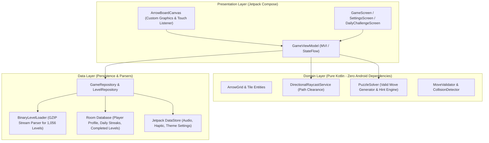
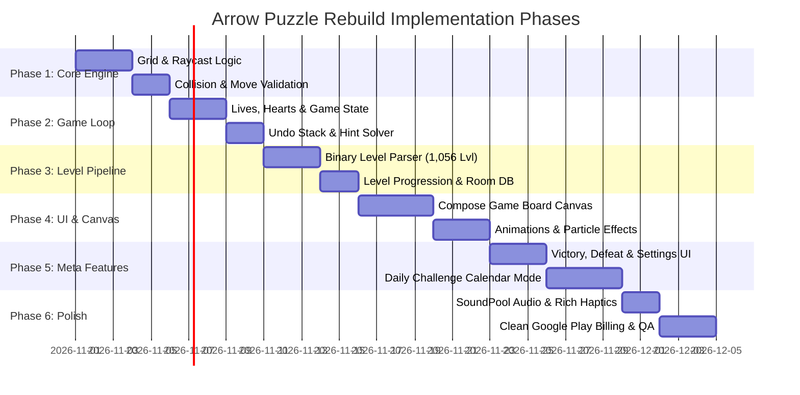

# Implementation Plan & Technology Stack Architecture

## 1. Executive Strategy & Recommended Technology Stack

Based on forensic findings from the original application, the recommended path for building a new, independent, significantly improved application is a **modern native Android application using Kotlin and Jetpack Compose**.

### 1.1. Native Android (Kotlin + Compose) vs. Unity Engine Comparison

| Architectural Dimension | Original APK (Unity 2022 Hybrid Shell) | Reimplementation (Native Kotlin + Jetpack Compose) |
| :--- | :--- | :--- |
| **Download Size** | **143.1 MB** (108 MB DEX + 35 MB Assets) | **< 15 MB** (~90% size reduction) |
| **Cold Startup Time** | ~4.0 – 6.5 seconds (Heavy engine init) | **< 300 milliseconds** (Instant interactive startup) |
| **Memory Footprint (RAM)** | ~280 MB – 450 MB | **~45 MB – 80 MB** (Smooth on low-end devices) |
| **Battery & GPU Usage** | High (Continuous OpenGL rendering loop) | **Extremely Low** (Event-driven Canvas redraws only on state changes) |
| **UI Rendering Tech** | Unity Canvas / TextMeshPro / ImGUI | **Jetpack Compose + Custom Canvas / SurfaceView** |
| **Display Refresh Rate** | Locked 60 FPS or variable stutter | **Native 120Hz / 90Hz ProMotion smoothness** |
| **Security Surface** | 133 Activities, 15 Third-Party SDKs | **1 Activity, 0 Exported Receivers, Zero Bloat** |

### 1.2. Proposed Application Identity
* **Proposed Package Name**: `com.arrowpuzzle.game` (Alternative: `com.puzzlearrow.master`)
* **Target Platforms**: Android API 26+ (Android 8.0 Oreo through Android 15/16)
* **Language & Runtime**: Kotlin 2.0+ (K2 compiler, Coroutines, StateFlow)
* **UI Framework**: Jetpack Compose (Material 3 with custom high-performance game Canvas)

---

## 2. Software Architecture: Clean Architecture + MVI

The application will follow strict **Clean Architecture** principles decoupled into three distinct layers:



---

## 3. Detailed Component Architecture

### 3.1. Domain Engine: Core Grid & Collision Math
* **Coordinate Model**:
  ```kotlin
  data class GridPosition(val x: Int, val y: Int)
  
  enum class Direction(val dx: Int, val dy: Int, val angleDegrees: Float) {
      UP(0, -1, 0f),
      RIGHT(1, 0, 90f),
      DOWN(0, 1, 180f),
      LEFT(-1, 0, 270f)
  }
  
  sealed interface ArrowType {
      data object Single : ArrowType
      data class TwoSided(val secondaryDirection: Direction) : ArrowType
      data class Layered(val depth: Int) : ArrowType
      data class Counter(val initialTaps: Int, val remainingTaps: Int) : ArrowType
  }
  
  data class ArrowEntity(
      val id: Int,
      val position: GridPosition,
      val direction: Direction,
      val type: ArrowType,
      val isEscaped: Boolean = false
  )
  ```
* **Raycasting Collision Logic**:
  ```kotlin
  fun canArrowEscape(arrow: ArrowEntity, board: Map<GridPosition, ArrowEntity>, bounds: IntSize): Boolean {
      var currX = arrow.position.x + arrow.direction.dx
      var currY = arrow.position.y + arrow.direction.dy
      
      while (currX in 0 until bounds.width && currY in 0 until bounds.height) {
          val blocker = board[GridPosition(currX, currY)]
          if (blocker != null && !blocker.isEscaped) {
              return false // Path obstructed
          }
          currX += arrow.direction.dx
          currY += arrow.direction.dy
      }
      return true // Path clear to boundary
  }
  ```

### 3.2. Level Data Pipeline (Binary Extraction & Compatibility)
* Implement a native Kotlin parser (`BinaryLevelLoader`) that reads the decoded `arrowsdata.dat` format:
  - Decompresses the 120-byte to 10-KB GZIP stream per level.
  - Instantiates `LevelData(id, width, height, arrows)`.
  - Supports loading both bundled offline levels (1,056 levels) and dynamic JSON level packs.

### 3.3. Presentation Layer: High-Performance Canvas Rendering
* **Jetpack Compose Custom Canvas**:
  - `drawIntoCanvas` with cached vector paths for sleek arrow shafts, triangular arrow heads, and soft drop shadows.
  - Hardware-accelerated transitions via `Animatable` and `spring()` physics easing.
  - Event-driven: Zero battery consumption when idle; renders 120 FPS during arrow fly-off animations.
* **Haptics & Audio**:
  - `VibratorManager` with rich vibration effects (`VibrationEffect.createPredefined(EFFECT_CLICK)` on tap, `EFFECT_HEAVY_CLICK` on collision, `EFFECT_DOUBLE_CLICK` on victory).
  - Low-latency sound playback via `SoundPool`.

---

## 4. Phased Implementation Roadmap



### Phase 1: Core Puzzle Engine & Grid Math
* **Goal**: Establish the mathematically verifiable domain model.
* **Deliverables**:
  - `ArrowGrid`, `ArrowEntity`, `Direction` domain models.
  - Directional raycaster and collision detector.
  - Multi-directional and layered arrow evaluation logic.
  - Comprehensive unit test suite verifying 100% test coverage over path clearing rules.

### Phase 2: Game State & Player Loop
* **Goal**: Implement game rules, turn handling, and player assists.
* **Deliverables**:
  - Lives/Hearts manager (3 hearts, collision penalty, game over trigger).
  - Undo move stack with complete spatial state rollback.
  - Deterministic hint solver (finds and highlights at least one unblocked arrow).
  - Coin economy and scoring calculator.

### Phase 3: Level Data Pipeline & Persistence
* **Goal**: Integrate the unpacked level database and persistence layer.
* **Deliverables**:
  - `BinaryLevelLoader` reading the 1,056 carved levels from `arrowsdata.dat`.
  - Room database schema (`PlayerProgressDao`, `CompletedLevelEntity`, `DailyChallengeEntity`).
  - Jetpack DataStore preferences (Sound, Music, Haptic, Theme).

### Phase 4: UI/UX & Compose Game Canvas
* **Goal**: Build the fluid, interactive visual frontend.
* **Deliverables**:
  - Compose `ArrowBoardCanvas` with touch gesture detection.
  - Smooth 120Hz launch animations (spring physics & cubic-bezier exit trajectories).
  - Collision wiggle/shake animations with directional bounce.
  - Responsive layout scaling across phone and tablet aspect ratios.

### Phase 5: Meta-Features & Modals
* **Goal**: Complete auxiliary game modes and user flows.
* **Deliverables**:
  - `WinModal` with star animations and coin counter increment.
  - `FailModal` with revive and restart actions.
  - `SettingsModal` with instant toggle switches.
  - `DailyChallengeScreen` with interactive monthly calendar grid.

### Phase 6: Polish, Monetization & Release Preparation
* **Goal**: Final production hardening and sound integration.
* **Deliverables**:
  - Low-latency audio integration with `SoundPool`.
  - Android 12+ rich tactile haptics.
  - Optional Google Play In-App Billing (No Ads, Starter Pack).
  - ProGuard/R8 optimization rules and release signing config.
