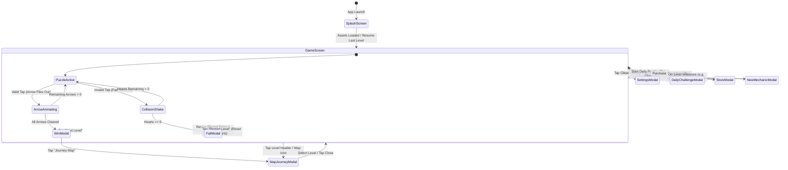

# Screen Flow & User Interface Specification

## 1. High-Level Screen Flow Architecture

The navigation architecture of **Arrow Puzzle** is organized around an immediate-play core loop: launching the app takes the player directly into the puzzle grid with zero friction. Auxiliary flows (Settings, Daily Challenges, Map Journey, Storefront) open as modal sheets or overlays over the primary game canvas.

---

## 2. Detailed Screen Specifications

### 2.1. Screen 1: Splash & Bootstrap (`SplashActivity` / `BootstrapSceneController`)
* **Purpose**: Application cold start, local save data decompression, font atlas binding, and runtime configuration initialization.
* **Visible Elements**:
  - Application logo centered on a clean dark or neutral gradient background.
  - Subtle pulsing loading indicator or progress bar.
  - Copyright and version text (`v1.11.0`) at the bottom edge.
* **User Actions**: Non-interactive; automatically dismisses upon resource readiness.
* **Navigation**:
  - Automatically transitions to `GameScreen` with the player's last active level loaded.
  - If first-time user, defaults directly to Level 1 without tutorial gating.
* **State Handling**:
  - *Loading*: Reads local save data (`arrowsdata.dat` index and `PlayerPrefs`).
  - *Error*: If save data is corrupted, resets gracefully to Level 1 with full coin balance intact.
* **Network & Persistence**:
  - Fully offline; does not block UI for network connections.

---

### 2.2. Screen 2: Primary Game Screen (`GameWindow_Standard` / `GameWindowTapContent`)
* **Purpose**: Primary interactive gameplay area where puzzles are solved.
* **Visible Elements**:
  - **Top Navigation Bar**:
    - Current Level Badge (e.g., "Level 42").
    - Pause / Settings Button (Gear icon).
    - Lives Display: 3 Heart containers (`Icn_Heart_Active_Full` / `Icn_Heart_Active_Shadow`).
    - Coins Display: Golden coin icon with animated counter balance.
  - **Center Canvas**:
    - Interactive 2D Arrow Board centered with proportional auto-scaling based on screen aspect ratio.
    - Arrows with clear directional styling (Up, Down, Left, Right), depth shadows, and dual-head symbols where applicable.
  - **Bottom Utility Bar**:
    - **Undo Button**: Circular button with counter badge (e.g., "5"); disabled if no moves have been made or balance is 0.
    - **Hint Button (`AHint`)**: Lightbulb icon with counter badge; highlights an unblocked arrow.
    - **Restart Button**: Quick-restart loop without penalizing progression.
* **User Actions & Input Validation**:
  - Single tap on any cell.
  - Touch input is locked during arrow exit animations (~200ms) to prevent race conditions.
  - Multi-touch is disabled on the game board to prevent erratic simultaneous launches.
* **Observable States**:
  - *Playing*: Grid responsive, hearts visible.
  - *Arrow Launch*: Smooth cubic-bezier trajectory easing towards the screen margin.
  - *Collision Shake*: Directional bounce with red tint overlay and haptic vibration.
* **Persistence**: Every arrow clearance updates the in-memory board state; level completion persists immediately to disk.

---

### 2.3. Screen 3: Victory Modal (`WinScreenWidget` / `WinScreen_Rays`)
* **Purpose**: Celebrates level completion, distributes coin rewards, and gates progression.
* **Visible Elements**:
  - Sunburst radial ray animation (`WinScreen_Rays`) behind trophy/star graphics.
  - "Level Complete!" banner.
  - Star Performance Rating (1 to 3 stars based on hearts preserved).
  - Coins Earned Banner (e.g., "+25 Coins").
  - Primary Action Button: "Next Level" (prominent green pill button).
  - Secondary Action Button: "Claim 2x with Ad" (optional video incentive).
* **User Actions**:
  - Tap "Next Level": Loads next consecutive level binary (`(N+1).bin`) and transitions smoothly back to `GameScreen`.
  - Tap "Claim 2x": Displays rewarded video, doubles coin award, and advances to next level.
* **Loading & Success States**:
  - Coins counter animates from old total to new total with audio chime.

---

### 2.4. Screen 4: Defeat / Out of Lives Modal (`FailPopUp` / `FailedResult`)
* **Purpose**: Informs player of failed attempt due to depleted hearts and offers revival paths.
* **Visible Elements**:
  - Broken heart graphic with somber animation.
  - "Out of Hearts!" title.
  - Action Button 1: "Revive for 100 Coins" (restores full 3 hearts; disabled if coin balance < 100).
  - Action Button 2: "Free Revive" (watch rewarded ad for +1 heart).
  - Action Button 3: "Restart Level" (neutral text button below main options).
* **Navigation & Transitions**:
  - Reviving keeps current board state intact (cleared arrows stay cleared) and grants hearts.
  - Restarting re-initializes the level to its original layout and resets hearts to 3.

---

### 2.5. Screen 5: Settings Sheet (`Block_Settings`)
* **Purpose**: Allows players to customize sensory and behavioral settings.
* **Visible Elements & Controls**:
  - Sound FX: Toggle switch (On/Off).
  - Background Music: Toggle switch (On/Off).
  - Haptic Feedback (Vibration): Toggle switch (On/Off).
  - Language: Dropdown / selector for localized text strings.
  - Legal & Info: Links to "Privacy Policy", "Terms of Service", and "Credits".
  - Close Button: (X) icon at top-right corner.
* **Input Validation & Persistence**:
  - All toggles apply instantly without requiring a "Save" button.
  - Settings are saved to local persistent storage immediately on change.

---

### 2.6. Screen 6: Daily Challenge Calendar (`DailyChallengeCacheManagerDataModel`)
* **Purpose**: Offers time-limited daily puzzle challenges with monthly streak rewards.
* **Visible Elements**:
  - Month & Year header with previous/next month navigation arrows.
  - 7x5 Day-of-month calendar grid.
  - Calendar Day Cells:
    - *Past Completed*: Marked with a golden star or checkmark.
    - *Current Day*: Highlighted with active pulsing border.
    - *Future Days*: Locked with padlock icon.
    - *Past Missed*: Marked as missed (unlockable with small coin fee).
  - Streak Progress Bar: Displays current continuous completion streak.
* **Navigation**:
  - Tapping an active or unlocked day launches that date's dedicated puzzle layout.

---

### 2.7. Screen 7: In-App Storefront (`FullScreenOffer`)
* **Purpose**: Monetization hub for virtual goods and ad removal.
* **Visible Elements**:
  - **Featured Hero Card**: "Remove Ads Forever" (one-time purchase).
  - **Starter Pack Card**: One-time offer with discounted coins + booster bundle.
  - **Coin Packs Grid**: Tiered coin options (e.g., 500, 1,200, 3,000, 7,500 coins).
  - "Restore Purchases" button in footer.
* **State Handling**:
  - *Loading*: Displays standard Android progress indicator while querying store catalog.
  - *Success*: Updates local coin wallet, dismisses store modal, and displays celebratory toast.
  - *Error*: Displays clean error alert if payment is cancelled or network is unreachable.

---

### 2.8. Screen 8: New Mechanic Introduction Modal (`New_Mechanics_Widget`)
* **Purpose**: Contextual onboarding when introducing new puzzle elements.
* **Visible Elements**:
  - Animated visual demonstration (e.g., showing a Two-Sided Arrow clearing in both directions, or an Under-Arrow being revealed after the top arrow leaves).
  - Headline (e.g., "Two-Sided Arrow!").
  - Description text explaining the rule in 1–2 concise sentences.
  - "Got It!" confirmation button.
* **Trigger Condition**:
  - Fires once upon entering the first level containing the new mechanic (e.g., Level 51).
  - Stored in local settings flags so it never interrupts the player a second time.
