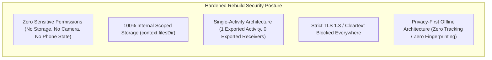

# Security & Permissions Audit

## 1. Executive Summary

This security audit inspects the permissions, exported attack surface, network trust boundaries, and data storage protections of `com.easybrain.arrow.puzzle.game` (version `1.11.0`).

The analysis reveals that while the app implements modern Android SDK targets (Target SDK 36), the inclusion of 15+ third-party ad mediation SDKs introduces substantial attack surface expansion, excessive permission requests, and unnecessary device metadata collection.

---

## 2. Declared Permissions Audit

The application requests **15 permissions** in `AndroidManifest.xml`. The following table analyzes the necessity, security implications, and risk rating of each declaration:

| Declared Permission | Protection Level | Declared Purpose in Original APK | Forensic Necessity | Rebuild Recommendation |
| :--- | :--- | :--- | :--- | :--- |
| `android.permission.INTERNET` | Normal | Network communication for ads, analytics, and billing | Required for online ads/IAP | **Retain** (if ads/IAP included) or **Omit** for pure offline build |
| `android.permission.ACCESS_NETWORK_STATE` | Normal | Verifies connectivity before dispatching network requests | High | **Retain** |
| `android.permission.ACCESS_WIFI_STATE` | Normal | Inspects Wi-Fi network state; used by ad SDKs for network quality and device fingerprinting | **Excessive / Low** | **Remove completely** (not required for standard connectivity checks) |
| `android.permission.VIBRATE` | Normal | Haptic feedback on arrow taps, collisions, and level victories | Legitimate | **Retain** (key gameplay sensory feedback) |
| `android.permission.POST_NOTIFICATIONS` | Dangerous (Runtime) | Android 13+ push notifications for daily streaks and life refills | Optional | **Retain** with explicit user opt-in prompt |
| `com.android.vending.BILLING` | Normal | Google Play In-App Billing for coin packs and ad removal | Legitimate | **Retain** (if supporting IAP) |
| `com.google.android.gms.permission.AD_ID` | Normal | Access to Google Advertising ID for attribution and targeted ads | High Tracking | **Remove** for privacy-first rebuild |
| `android.permission.ACCESS_ADSERVICES_TOPICS` | Normal | Android Privacy Sandbox Topics API | High Tracking | **Remove** |
| `android.permission.ACCESS_ADSERVICES_ATTRIBUTION` | Normal | Privacy Sandbox Attribution reporting | High Tracking | **Remove** |
| `android.permission.ACCESS_ADSERVICES_AD_ID` | Normal | Privacy Sandbox Attribution identifier | High Tracking | **Remove** |
| `android.permission.WAKE_LOCK` | Normal | Prevents CPU sleep during background WorkManager synchronization | Medium | **Remove** (use modern WorkManager defaults) |
| `android.permission.WRITE_EXTERNAL_STORAGE` | Dangerous | Legacy storage writing; scoped with `android:maxSdkVersion="18"` | Legacy Stub | **Remove completely** |
| `android.permission.READ_EXTERNAL_STORAGE` | Dangerous (Runtime) | Requested by Zendesk support image picker and ad cache | **Excessive / High** | **Remove completely** (Use Android Photo Picker if attachments needed) |
| `com.google.android.c2dm.permission.RECEIVE` | Signature | Legacy Google Cloud Messaging / FCM receiver | Legacy | **Remove** (Modern FCM uses platform components) |
| `com.android.vending.CHECK_LICENSE` | Normal | Google Play Licensing (LVL) verification | Optional | **Omit** unless strict DRM licensing is required |

---

## 3. Excessive & Sensitive Permissions Assessment

1. **`READ_EXTERNAL_STORAGE` (Dangerous Permission)**:
   - *Risk*: Grants broad access to user photos, media, and files on devices running older Android versions.
   - *Forensic Cause*: Declared to support Zendesk's legacy attachment picker (`zendesk_user_attachments.xml`) and ad caching.
   - *Remediation*: Eliminating the Zendesk SDK completely removes the need for broad storage permissions. For modern Android, apps must use internal app storage (`context.filesDir`) or the zero-permission Android Photo Picker.
2. **`ACCESS_WIFI_STATE` (Fingerprinting Risk)**:
   - *Risk*: Allows collecting Wi-Fi BSSID/SSID and network interface attributes, historically abused by ad tracking libraries for persistent cross-app device fingerprinting.
   - *Remediation*: Modern Android networking APIs (`ConnectivityManager.NetworkCallback`) provide complete network state monitoring without requiring Wi-Fi inspection permissions.
3. **Hardware Feature Queries (`android.hardware.camera`)**:
   - The manifest declares `<uses-feature android:name="android.hardware.camera" android:required="false" />`.
   - While marked non-required, query declarations reveal that ad SDKs inspect camera availability. A pure puzzle game has zero legitimate use for camera hardware.

---

## 4. Attack Surface Audit: Component Exposure

The original application declares an immense component surface:
* **133 Activities**
* **18 Services**
* **19 Broadcast Receivers**

### 4.1. Exported Component Analysis
Only a small fraction of components are exported (`android:exported="true"`):

| Component | Type | Exported | Intent Filters / Purpose | Security Evaluation |
| :--- | :--- | :--- | :--- | :--- |
| `com.easybrain.template.SplashActivity` | Activity | `true` | `MAIN`, `VIEW`, `LAUNCHER`, deep links | Correctly exported; entry point |
| `com.easybrain.template.TemplateActivity` | Activity | `true` | `MAIN` | Core Unity host activity |
| `com.easybrain.AppVisibilityReceiver` | Receiver | `true` | None (explicit) | Receives app foreground events |
| `com.google.firebase.iid.FirebaseInstanceIdReceiver` | Receiver | `true` | `com.google.android.c2dm.intent.RECEIVE` | Protected by Google Play services signature |
| `com.mbridge.msdk.foundation.same.broadcast.NetWorkChangeReceiver` | Receiver | `true` | `CONNECTIVITY_CHANGE` | Legacy network receiver; unnecessary on modern Android |
| `com.ogury.core.internal.LogEnablerReceiver` | Receiver | `true` | `com.ogury.sdk.intent.ENABLE_LOGS` | Debug logger trigger; potential information leakage vector |

### 4.2. Security Weaknesses in Original App (Non-Exploited)
1. **Third-Party SDK Code Execution**: By bundling 15 distinct ad networks and mediation adapters, the app executes third-party native and bytecode within its process space, significantly expanding its vulnerability footprint.
2. **Cleartext Traffic Exemptions**: As discovered in `modules_network_security_config.xml`, cleartext HTTP traffic is explicitly whitelisted for several ad CDN subdomains, exposing creative traffic to network manipulation on untrusted Wi-Fi hotspots.
3. **Complex Deep Link Handling**: `SplashActivity` accepts broad URI schemas without cryptographic origin validation.

---

## 5. Security & Hardening Architecture for Rebuild

For the clean-room reimplementation, the security posture will be radically simplified and hardened:

### 5.1. Hardening Checklist for Clean Application
* [x] **Zero Dangerous Permissions**: The rebuild will request **zero dangerous permissions**. No runtime permission dialogs will interrupt the user.
* [x] **Strict Internal Storage**: All game levels, save progress, and player settings will reside exclusively in `context.filesDir` (sandbox-isolated, protected by Linux file permissions).
* [x] **Elimination of Cleartext**: The network security configuration will enforce `cleartextTrafficPermitted="false"` globally with zero domain exceptions.
* [x] **Minimized Component Exposure**: Exactly **one** exported activity (`MainActivity` with launcher intent). Zero exported receivers or services.
* [x] **Zero Tracking Footprint**: Complete removal of Adjust, Facebook, and ad tracking SDKs ensures 100% compliance with COPPA, GDPR, and Google Play Families Policy out of the box.
